# SentinelForge — Autonomous SOC War Room

[]()
[]()
[]()
[]()

> An autonomous Security Operations Center built on **open-source LLMs** — it folds alert storms
> into incidents, triages them with specialist agents, and contains threats with a human in the
> loop on every irreversible action.

## At a glance

| Metric | Value |
|--------|-------|
| Noise reduction (correlation engine) | ~67–97% (demo: 30 alerts → 1 incident = 96.7%) |
| Triage verdict accuracy | 0.94 |
| False-positive suppression | 1.00 |
| Red-team guardrail tests | 24 passing |
| Total test suite | 135 passing |
| Model stack | Groq Llama 3.3 70B (`smart`) + Llama 3.1 8B (`fast`) |

```mermaid
flowchart LR
    SRC[SIEM / EDR / IDS / Email] --> HMAC[HMAC + Injection Guard]
    HMAC --> CORR{Correlation Engine}
    CORR -->|fold| INC[Incident]
    CORR -->|new| INC
    INC -->|Redis Streams| AGENTS

    subgraph AGENTS[War Room — 5 Agents]
        T[CMDR - Triage]
        I[ANLST - Investigate]
        R[STRAT - Contain Plan]
        E[OPS - Execute]
        P[CHRON - Post-Incident Report]
    end

    AGENTS --> HITL{HITL Gate}
    HITL --> APPROVED

    subgraph SAFETY[Action Safety Layer]
        G[Guardrails]
        G --> DENY[DENY - un-overridable]
        G --> DRY[Dry-Run → Execute → Verify → Rollback]
    end

    APPROVED --> G
    DENY --> AUDIT[Hash-Chained Audit Log]
    DRY --> REAL[Cloudflare / Adapters]
    REAL --> AUDIT
    AGENTS -.-> SSE[SSE → Dashboard]
    AUDIT -.-> EVAL[CI Eval Gate · 0.94 acc]
```



## Headline features

### 🔗 Alert correlation & dedup engine
Fingerprinted + entity-overlap based; storms and cross-tool duplicates collapse into **one**
incident instead of N pipeline runs. Deterministic (no model call), instant, explainable.

```bash
python demo/seed_alerts.py --storm 30
# 30 alerts → 1 incident, 29 folded  ·  noise reduction: 96.7%
```

### 🎯 Detection-as-code (Sigma rule generation)
Every contained incident can generate a **valid Sigma YAML rule** from its IOCs + MITRE techniques
via `POST /api/v1/incidents/{id}/detection-rule`. Deterministic templates per technique family
(T1110, T1059, T1071, T1486, T1566, T1078, T1190, T1041 + generic); LLM refines only
title/description. Rules land in `detections/generated/` and appear in the incident UI.

### 📤 STIX 2.1 + ATT&CK Navigator export
`GET /api/v1/incidents/{id}/export/stix` → STIX 2.1 bundle (indicators, attack-patterns,
report, relationships) that loads into any CTI platform. `GET /api/v1/analytics/navigator-layer`
→ ATT&CK Navigator heat map coloring observed techniques by frequency.

### 🎯 Proactive threat-hunt generator
From a MITRE technique or free text, generates falsifiable hunt hypotheses with **runnable
queries** (Splunk SPL / Elastic EQL / KQL / Sigma).

### 🔒 Deterministic action safety — the LLM proposes, guardrails dispose
Every mutating action flows `propose → guardrails → dry-run → execute → verify → rollback`.
A **DENY is absolute** — no approval and no model output can override it. Protected targets,
blast-radius caps, global kill switch, two-person rule for CRITICAL, change-freeze windows,
dry-run by default. **24 red-team tests** encode the guarantee:

```
block_ip 8.8.8.8    → DRY_RUN_OK        block_ip 10.0.0.5     → DENIED
suspend j.doe       → DRY_RUN_OK        suspend svc-account   → DENIED
isolate prod-app-03 → DRY_RUN_OK        isolate dc-01         → DENIED
```

One **real** adapter ships: Cloudflare IP Access Rules (free tier) — execute creates a block rule,
verify reads it back, rollback deletes it. Env-gated; mock fallback for zero-key demos.

### 🧠 Live reasoning trace on open models
High-severity triage streams reasoning → sentinel → JSON verdict in a single call, giving a
genuine live thinking trace on any OSS model.

### 📊 CI-gated triage eval (0.94 acc, 1.00 FP suppression)
An offline harness scores triage against a labeled corpus and **fails CI** if quality drops:

```bash
python -m app.eval.harness         # heuristic baseline → GATE: PASS (0.94 acc, 1.00 FP sup)
python -m app.eval.harness --llm   # score the real model
```

### 🛡️ RBAC + signed approvals (JWT · two-person rule)
- JWT login with `viewer`/`analyst`/`approver`/`admin` roles enforced as FastAPI dependencies.
- Approval endpoints read identity **from the verified token only** — no forgeable body fields.
- **Two-person rule**: critical actions need two *distinct authenticated* approvers.
- Dev bypass (`auth_dev_bypass=true`) so docker-compose demos work without tokens.

### 🔄 Analyst feedback flywheel
Analysts correct triage verdicts via `POST /api/v1/incidents/{id}/feedback`. Corrections become
labeled eval data (`app/eval/feedback_export.py`) that tightens the CI quality gate —
a real continuous-learning loop.

### 📈 Prometheus + Grafana observability
`/metrics` endpoint with pipeline-stage latency histograms, alert ingested/folded counters,
action status counters, LLM tokens/latency, approval-queue depth. `docker compose --profile
observability up` starts prometheus + a provisioned Grafana dashboard.

### 🛡️ Tamper-evident audit + prompt-injection defense
Every agent and human action is hash-chained — any edit, deletion, or reorder is detectable
(`GET /api/v1/security/audit/verify`). Every ingested finding passes a prompt-injection guard;
webhooks are HMAC-verified.

## Purple-team self-assessment

```bash
python -m app.purple
```

Replays scripted MITRE attack chains (credential assault, ransomware run, recon probe) through
the real ingestion pipeline and prints a **Detection Scorecard**:
- Alerts folded vs expected
- Techniques correctly mapped
- Verdict accuracy
- Time-to-triage
- **Correlation detection rate**

The project red-teams itself. Results at `GET /api/v1/analytics/purple`.

## Trust model

- **LLM proposes, guardrails dispose.** The model generates plans; a deterministic engine
  authorizes every mutating action. A DENY is absolute — no approval and no model output can
  override it.
- **Dry-run default.** Every action runs in dry-run mode first (`ACTION_DRY_RUN_ONLY=true`);
  only deliberate operator action enables live execution.
- **Two-person rule.** CRITICAL-severity containment requires approval from two distinct,
  authenticated operators.
- **Hash-chained audit.** Every action (agent and human) is written to a tamper-evident audit
  log. The chain root is published via `GET /api/v1/security/audit/verify`.
- **CI-gated triage quality.** An offline eval harness scores every model change against a
  labeled corpus and blocks regressions below 0.90 verdict accuracy.

## Quick start

```bash
cd alertforge
cp .env.example .env                       # API keys optional — works with zero keys
docker compose up -d                        # full stack in ~30s
open http://localhost:3000

# Seed a full pipeline run
python demo/seed_alerts.py --scenario brute_force

# Watch alert storms fold into one incident
python demo/seed_alerts.py --storm 30

# Purple-team self-assessment
python -m app.purple
```

Get a free Groq API key at <https://console.groq.com/keys> and add `LLM_API_KEY=gsk_...` to
`.env`. Without a key, every LLM call and external tool returns deterministic mocks — the
dashboard tells a complete story.

See [DEMO.md](DEMO.md) for a 3-minute demo walk-through.

## Engineered for open-source models

SentinelForge is tuned around what small/mid OSS models are good and bad at:

- **Tool *selection*, not tool *dumping*.** Instead of sending all ~20 tools every round, a
  deterministic selector exposes a small, relevant, **read-only** toolset per incident (by
  category / ATT&CK technique / entities present). A brute-force incident sees 5 tools, not 20 —
  ~75% fewer tool-schema tokens per round and far fewer hallucinated tool names.
- **Deterministic-first, model-second.** Correlation, entity extraction, tool selection, and hunt
  templates are pure functions. The model is spent only on judgment and synthesis — the things it's
  actually good at. This also means the whole system degrades gracefully to a working demo with
  **zero API keys**.
- **Robust structured output.** A hardened JSON extractor (fence-stripping + brace-balancing) plus
  one automatic *repair* round-trip recovers the malformed / truncated / prose-wrapped JSON that
  OSS models routinely emit — no strict `json_schema` required (Groq doesn't support it).
- **Two-tier model routing.** A `smart` 70B-class tier for judgment and tool loops; a cheap `fast`
  8B-class tier for classification and normalization. The 70B budget is spent only where it changes
  the outcome. An optional dedicated reasoning model is used for the hardest triage calls.
- **Provider-neutral.** Any OpenAI-compatible endpoint works — Groq, Together, Fireworks, a local
  vLLM/Ollama. Point `LLM_BASE_URL` + `LLM_API_KEY` wherever you like.

## Stack

Python 3.12 · FastAPI · asyncpg / PostgreSQL · Redis 7 (Streams + pub/sub) · ChromaDB ·
Next.js 15 · SSE · docker compose · any OpenAI-compatible LLM (Groq by default)

## Notes on realism

External integrations (VirusTotal, AbuseIPDB, Elasticsearch,
Slack, JIRA) call the real API when you provide a key and otherwise return deterministic mocks.
The correlation engine, tool selection, HITL gate, and pipeline orchestration are real and tested
([backend/tests](backend/tests/test_pure_functions.py)).

See [ARCHITECTURE.md](ARCHITECTURE.md) for the full system design and [DEMO.md](DEMO.md) for a
3-minute demo script.

**Roadmap:** See [TASK.md](TASK.md) for the prioritized build plan (RBAC, Cloudflare adapter,
Sigma rules, purple-team harness, STIX export, Prometheus, feedback flywheel, and polish).

## License

MIT
